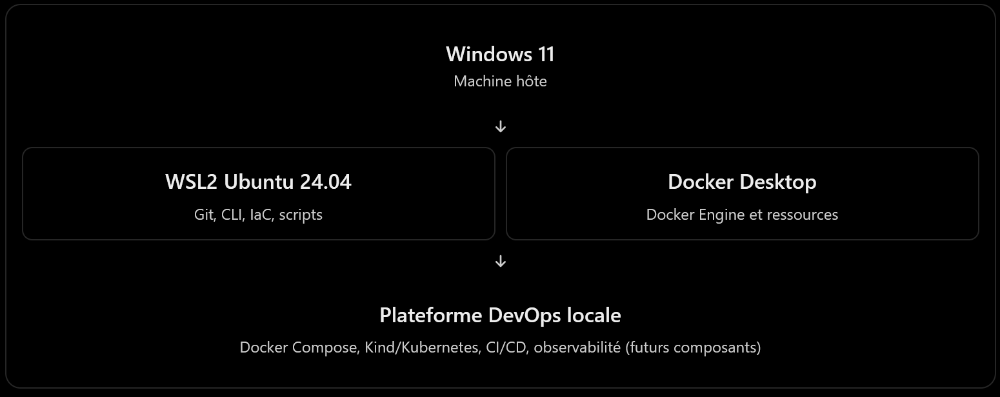

# ADR-0001 — Docker Desktop avec WSL2

- Statut : Accepté
- Date : 2026-11-08

## Contexte

Le projet Modern DevOps Platform est développé
sur Windows 11 avec Ubuntu 24.04 sous WSL2.

La plateforme doit héberger plusieurs composants
DevOps locaux tout en restant reproductible.

## Décision

Utiliser Docker Desktop comme moteur Docker
unique, accessible depuis Ubuntu WSL2.

Ne pas installer de second Docker Engine
directement dans Ubuntu.

## Justification

- Intégration native Docker Desktop / WSL2
- Gestion centralisée des conteneurs
- Compatibilité Docker Compose
- Compatibilité avec Kind pour Kubernetes
- Réduction de la complexité d'exploitation

## Conséquences

Positives :
- Environnement cohérent
- Maintenance simplifiée
- Moins de risques de conflits Docker

Contraintes :
- Dépendance à Docker Desktop
- Consommation des ressources de la machine hôte

## Validation

Audit réalisé :
- Docker Desktop opérationnel
- Docker CLI accessible depuis WSL2
- Docker Engine fonctionnel
- Aucun second Docker Engine installé dans Ubuntu